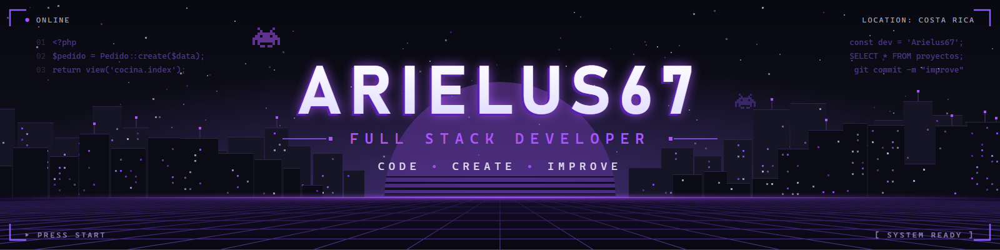
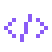
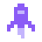
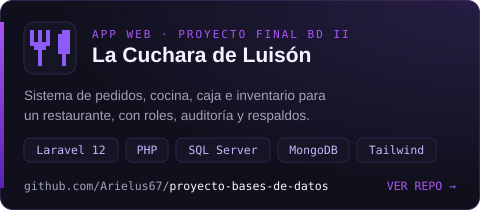
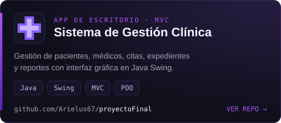
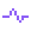
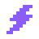

<!--
  ARIELUS67 · GitHub Profile
  Identidad: Dark Developer / Purple Neon / Cyberpunk minimalista
  Paleta: #080811 #10101C #151526 · #8B5CF6 #A855F7 #5B21B6 · #F5F3FF #A1A1B5 · #30234A
  Recursos propios en /assets (banner, iconos pixel art, tarjetas de proyecto, separador, footer)
-->

<div align="center">



<br/><br/>

¡Hola! Soy **Ariel**, un desarrollador apasionado por la tecnología, el desarrollo web<br/>
y la creación de soluciones digitales, desde **Costa Rica**.

<br/>

<a href="https://github.com/Arielus67"></a>

<a href="https://github.com/Arielus67?tab=followers"></a>


</div>



##  Sobre mí

```javascript
const ariel = {
    username:  "Arielus67",
    country:   "Costa Rica",
    role:      "Full Stack Developer",
    interests: ["Web Development", "Software Development", "Databases", "Gaming"],
    motto:     "Code. Create. Improve."
};
```

- **Full Stack Developer en formación**, enfocado en el desarrollo web.
- Construyo aplicaciones con **PHP y Laravel**.
- Diseño y administro **bases de datos** relacionales y no relacionales.
- Me apasionan los **videojuegos** y la tecnología.
- Aprendizaje continuo: siempre hay una herramienta nueva por explorar.


##  Tecnologías

<div align="center">

<sub><b>PROGRAMMING LANGUAGES</b></sub><br/>


<sub><b>FRAMEWORKS &amp; LIBRARIES</b></sub><br/>


<sub><b>DATABASES</b></sub><br/>

&nbsp;

<sub><b>TOOLS &amp; PLATFORMS</b></sub><br/>


</div>


##  Proyectos destacados

<div align="center">

<a href="https://github.com/Arielus67/proyecto-bases-de-datos"></a>
<a href="https://github.com/Arielus67/proyectoFinal"></a>

</div>

<!--
  Para agregar un proyecto nuevo, duplica una tarjeta de /assets (project-*.svg),
  cambia el texto y enlázala aquí con su repositorio.
-->


##  Estadísticas de GitHub

<div align="center">


</div>

###  Trofeos

<div align="center">


</div>


##  Actividad de contribuciones

<div align="center">


<picture>
  <source media="(prefers-color-scheme: dark)" srcset="https://raw.githubusercontent.com/Arielus67/Arielus67/output/github-snake-dark.svg"/>
  <source media="(prefers-color-scheme: light)" srcset="https://raw.githubusercontent.com/Arielus67/Arielus67/output/github-snake.svg"/>
  
</picture>

</div>


##  Actualmente trabajando en

```text
▸ Desarrollo de aplicaciones web          ▸ Sistemas con PHP y Laravel
▸ Administración de bases de datos MySQL  ▸ Docker y herramientas DevOps
▸ Videojuegos y servidores de Minecraft   ▸ Exploración de nuevas tecnologías
```

##  Mis objetivos

- [ ] Convertirme en un desarrollador Full Stack sólido.
- [ ] Crear aplicaciones reales y funcionales.
- [ ] Mejorar mis habilidades de arquitectura de software.
- [ ] Aprender nuevas tecnologías.
- [ ] Construir proyectos que aporten valor.
- [ ] Contribuir a proyectos de código abierto.


##  Conectemos

<div align="center">

<a href="https://github.com/Arielus67"></a>
<!-- LinkedIn: reemplaza TU_USUARIO y quita el comentario
<a href="https://www.linkedin.com/in/TU_USUARIO"></a>
-->
<!-- Correo: reemplaza TU_CORREO y quita el comentario
<a href="mailto:TU_CORREO"></a>
-->

</div>

<br/>

<div align="center">

> *"El código de hoy es la tecnología del mañana."*



**CODE • CREATE • IMPROVE** 💜

<sub>Gracias por pasar por aquí. ¡Nos vemos en el próximo commit!</sub>

</div>
